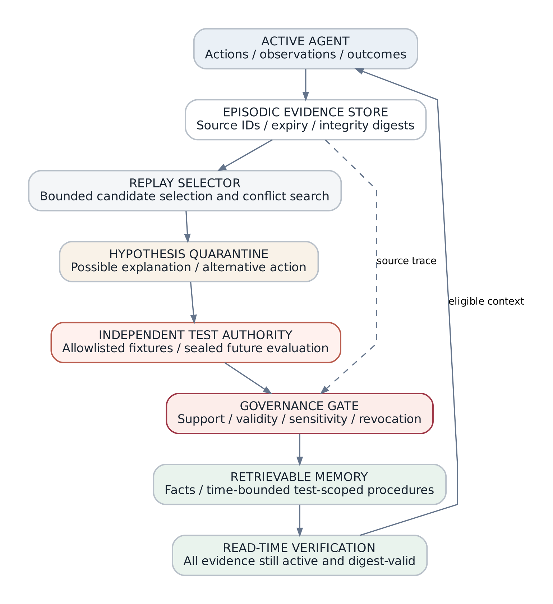
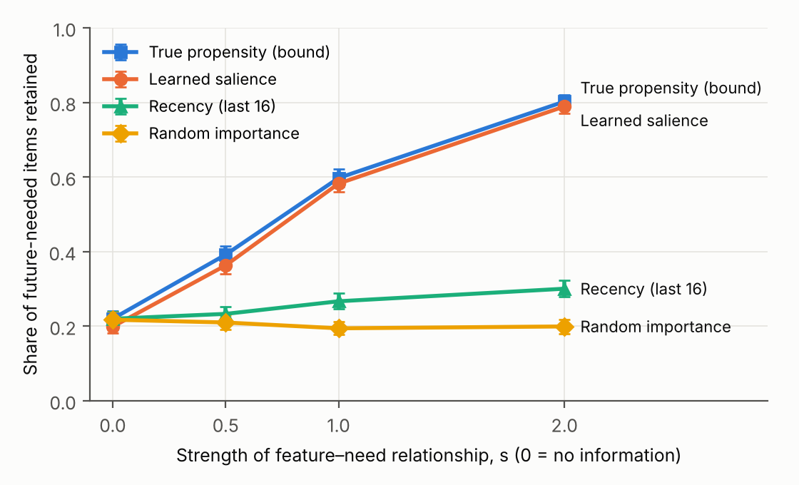
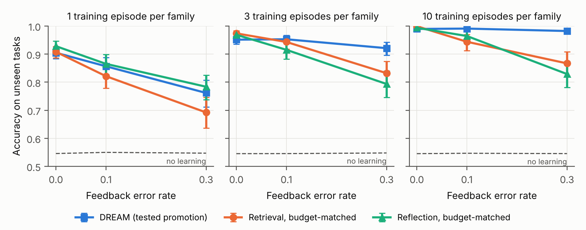

# Research Gate Document

## DREAM: Evidence-Governed Counterfactual Consolidation for Persistent AI Agents

**Lakshminarasimhan Santhanam**
9 November 2026

### Abstract

I study artificial dreaming as an accountable computation: a persistent agent revisits experience, proposes alternatives, tests them under an authority it does not control, and promotes only supported memories. I call the architecture DREAM (Deliberative Replay, Evaluation, Abstraction and Memory) and release a standard-library Python/SQLite reference implementation that passes 40 unit tests. I test four of five hypotheses in controlled simulations, each against an explicit falsifier. Salience learned from earlier streams retains 58.2% of future-needed items against 26.7% for recency and a 59.8% information bound, but it offers no gain when features carry no signal (-2.1 [-4.9, +0.5] points) and collapses to recency under distribution shift. Tested counterfactual promotion does not beat budget-matched retrieval or reflection when feedback is clean (-1.7 [-2.8, -0.8] points with three episodes), but it does when feedback is noisy (+15.3 [+10.8, +20.4] points with ten episodes at 30% feedback error, with no regressions), and it falls below the untrained baseline when the test authority encodes the wrong convention (41.5% against 54.8%). Evidence governance blocks low-trust poisoning but serves a single forged `validated` record as verified, and any non-untrusted contradiction withholds a true fact; corroboration and evidence-dominance options reduce these failures but are defeated by two forged sources. A randomized lifecycle check finds zero invariant violations across 65,186 served memories, while a mutant without read-time revalidation produces 24,685. The results support a narrower thesis than "dreaming helps": tested promotion helps exactly when the test authority is more reliable than the agent's own feedback, and governance is only as strong as source authentication.

**Keywords:** computational dreaming; persistent agents; evidence provenance; counterfactual evaluation; memory poisoning; epistemic governance; memory consolidation.

## 1. The problem of experience without learning

An agent that remembers an event has not necessarily learned from it. A transcript can store the actions that led to a failure without encoding which decision was causal, what alternative would have worked, or when the lesson ceases to apply. A summary adds a second failure mode: it can turn an uncertain explanation into a durable rule that later retrieval presents as settled. A memory system intended to improve behaviour must therefore do more than compress or index prior tokens.

I define **computational dreaming** as a finite process, run away from the immediate decision loop, that reconsiders selected experiences, formulates alternative actions, evaluates them against evidence the proposer does not control, and updates reusable memory only when a declared promotion policy permits it. The term is functional, not biological. I do not imply sleep, subjective experience or changes to neural-network weights.

My question is: **under what conditions does evidence-governed counterfactual consolidation make an otherwise identical agent more accurate or safer on unseen tasks than retrieval-only and reflection-only alternatives at a comparable budget?** I phrase it conditionally on purpose. A mechanism that sometimes helps and sometimes harms is only useful if the conditions are known.

I make five contributions:

1. An architecture that separates evidence, quarantined hypotheses, test authority and reusable memory (Section 3).
2. A reference implementation with read-time evidence revalidation, two optional promotion policies (corroboration and evidence dominance), and a registry of six procedural task families with independent fixture generators (Section 5).
3. Four controlled simulation studies, each tied to a hypothesis and an explicit falsifier (Section 6), with confidence intervals, null conditions and budget-matched baselines.
4. A characterisation of when the mechanism fails: clean feedback, a misspecified test authority, distribution shift, and forged evidence labels.
5. A sharper thesis, supported within these simulations: the benefit of tested promotion is the benefit of an independent test authority, and it disappears or reverses when that authority is no better than the agent's own feedback.

I do not claim a theory of human sleep, a learned world model, results on language-model agents, or production security.

## 2. Scientific context and conceptual boundary

Offline improvement predates language-model agents. Dyna integrated trial-and-error learning with planning over a learned model of the world [1]. Prioritised experience replay showed that replaying informative transitions more often improves learning [2]. Complementary learning systems theory distinguishes rapidly stored episodes from slowly integrated structure [3]. Reconsidering prior experience is therefore not a novelty claim on its own.

Language-based systems are closer comparators. Generative Agents combined observation, reflection and retrieval for simulated social behaviour [4]. Reflexion improved later decisions through verbal feedback stored in an episodic buffer, without weight updates [5]. MemGPT treated context management as a memory hierarchy [6]; A-Mem introduced evolving, interconnected memory notes [7]. DreamerV3 shares the terminology but learns a world model and optimises behaviour in imagined latent trajectories [8]; DREAM does neither.

Evaluation work defines the burden of proof. LongMemEval tests information extraction, multi-session reasoning, temporal reasoning, knowledge updates and abstention [9]; LoCoMo stresses very long dialogues [10]; LongMemEval-V2 targets environment experience such as state changes, workflows and recurring pitfalls [11]. AgentPoison showed that poisoning memory or knowledge bases can redirect agents [12], and provenance-aware memory systems now combine evidence traces with citation and retrieval constraints [13].

The contribution I test is narrow: **a promotion pathway in which a proposed change to behaviour must pass a test the proposer does not control, and in which every served memory must still be supported at read time.** Section 6 asks when that pathway adds value beyond its antecedents.

## 3. Operational definition and architecture

At decision step \(t\) the agent has a fixed base policy \(\pi_0\), an episodic evidence set \(E_t\), a consolidated memory set \(M_t\), a quarantined hypothesis set \(H_t\) and a bounded test authority \(V\). A dream operator with budget \(B\) and governance policy \(G\) updates the state:

\[
(H_{t+1},\, M_{t+1}) = D_B\big(E_{\le t},\, H_t,\, M_t;\; V,\, G\big).
\]

The system distinguishes a generated counterfactual from a tested procedure, and a tested procedure from a generalisable skill.

{width=74%}

**Figure 1.** The evidence store is the source of record. Hypotheses gain no retrieval authority from being generated. Promotion retains source references and test scope, and the same validation applies when memory is read.

### 3.1 Episodic evidence

An experience is a record \(e_i = (\mathrm{id}, u, s, p, v, \tau, \rho, k, q, \eta, x)\): tenant \(u\), assertion \((s, p, v)\), timestamp \(\tau\), source identifier \(\rho\), event kind \(k\), declared evidence class \(q \in \{\texttt{untrusted}, \texttt{observed}, \texttt{self\_report}, \texttt{validated}\}\), sensitivity \(\eta\) and outcome metadata \(x\). The evidence class is supplied by the caller and is not authenticated; Section 6.6 measures what follows from that.

Each record carries a SHA-256 digest over all thirteen stored fields, rechecked before consolidation and at every read. This detects unrecorded row changes. It is not tamper resistance against an actor who can rewrite the database and recompute an unkeyed digest.

### 3.2 Memory as a claim with dependencies

A consolidated memory is \(m_j = (c_j, z_j, R_j, \ell_j, \eta_j, \kappa_j)\): content, workflow status, supporting evidence identifiers, a relevance weight, sensitivity and, for procedures, the test scope. Statuses are `verified`, `reported`, `pending`, `contested`, `quarantined`, `sandbox_verified`, `stale` and `expired`. They are workflow states, not probabilities; the stored weights (for example 0.95 for `verified`) are ranking priorities, not calibrated confidence.

The central invariant applies to facts and procedures alike:

\[
\mathrm{Retrievable}(m, t) \;\Rightarrow\; \forall e \in R(m):\; \mathrm{Exists}(e) \,\wedge\, \mathrm{Active}(e, t) \,\wedge\, \mathrm{DigestValid}(e).
\]

### 3.3 Replay, conflicts and promotion policies

Replay orders events by evidence class, then by a heuristic score \(0.6\,\mathrm{importance} + 0.25\,[\text{kind} \in \{\text{correction}, \text{outcome}\}]\), then by recency. Ties in importance therefore resolve to the newest events.

Values that disagree on the same key are handled by one of two contest policies:

- **any** (default): any disagreement among non-`untrusted` evidence marks the key `contested` and withholds it. Only `untrusted` disagreements are recorded without effect.
- **dominance**: each value's strength is the pair (best evidence class, number of distinct sources at that class). A value that strictly exceeds every alternative stays servable and the disagreement is kept in metadata; ties remain contested.

A fact backed by `validated` evidence becomes `verified` when at least \(n_{\min}\) distinct validated sources agree (default \(n_{\min} = 1\)); with fewer it is served as `reported`. Source identifiers are caller-supplied, so both options raise an attacker's cost rather than prove anything.

The subject–predicate key has no valid-time or context semantics, so a legitimate change of state can be misread as a contradiction. I treat temporal scoping as required future work.

### 3.4 Counterfactuals and test authority

A counterfactual is \(h = (s, a_0, a_1, \mathcal{T}, \rho_h)\): in situation \(s\), use action \(a_1\) instead of the observed \(a_0\), judged on a test collection \(\mathcal{T}\) generated independently of the triggering episode, with supporting evidence \(\rho_h\). Hypotheses stay quarantined until tested. A hypothesis is promoted only when its fixture score beats the current action by a declared margin (at least 2 of 20 fixtures in Section 6.5). The proposer cannot edit fixtures, labels or the scoring rule.

## 4. Hypotheses and falsifiers

Let \(Y_i(\pi)\) be success of policy \(\pi\) on unseen task \(i\). The effects of interest at matched budget \(B\) are

\[
\Delta_{D,R} = \mathbb{E}\big[Y(\pi_D) - Y(\pi_R) \mid B\big], \qquad
\Delta_{D,F} = \mathbb{E}\big[Y(\pi_D) - Y(\pi_F) \mid B\big],
\]

for DREAM \(\pi_D\), retrieval-only \(\pi_R\) and reflection-only \(\pi_F\). I state five hypotheses, each with the observation that would refute it.

**H1 — Learned relevance.** Selection driven by salience estimated from past experience retains more future-needed items than recency at equal capacity. *Falsifier:* no advantage when target labels are unavailable, or an advantage that persists when features are uninformative (which would indicate leakage).

**H2 — Counterfactual transfer.** Tested promotion improves accuracy on unseen tasks over retrieval-only and reflection-only memory at equal total budget. *Falsifier:* no positive paired difference against budget-matched baselines, or an unacceptable regression rate.

**H3 — Epistemic governance.** Evidence-dependent promotion reduces poisoned-memory acceptance without suppressing legitimate knowledge. *Falsifier:* attacks pass the promotion boundary, or protection comes only from withholding true facts.

**H4 — Evidence lifecycle.** No served memory lacks active, tenant-local, digest-valid support after expiry, tampering or deletion. *Falsifier:* any served memory with invalid support.

**H5 — Scheduling efficiency.** Event-triggered consolidation yields more task utility per unit of compute than fixed-period or full replay. *Not tested here.*

## 5. Reference system

The implementation uses only the Python standard library and SQLite. Its parts are the `Event` record and `DreamEngine` (ingestion, dream cycle, recall, audit, purge), a registry of six procedural task families (`dreamlab/families.py`), an optional localhost-only language-model proposer whose outputs are stored as untested hypotheses, and the experiment runners in `experiments/`. No external model, network credential or downloaded dataset is required.

The engine workflow is: ingest an explicitly permitted event and record its digest; select a finite replay sample and recheck integrity; group assertions and apply the contest and corroboration policies; evaluate allowlisted counterfactuals; promote only on a declared improvement rule; and, on every read, filter by sensitivity and revalidate every supporting event's existence, expiry and digest.

This is a single-user local research instrument. Tenant and clearance strings are not proof of identity, the database is not encrypted, purge is logical rather than forensic deletion, and lexical retrieval is not semantic reasoning.

## 6. Evaluation

I separate three classes of evidence. **Software conformance** (Section 6.1) shows the code does what it specifies. **Controlled simulation** (Sections 6.2–6.6) measures each mechanism under stated assumptions, with null conditions and stress tests. **External evaluation** on language-model agents and public benchmarks has not been run; Section 7 specifies it. All experiments are deterministic given their seeds and regenerate with `run_all.sh`. Intervals are 95% percentile bootstrap intervals over the stated units.

### 6.1 Software conformance

The suite contains 40 tests: 33 covering ingestion permission, tenant labels, sensitivity filtering, contradiction states, the arithmetic fixture, hypothesis quarantine, integrity mismatches, expiry of procedures, untrusted-source flooding and read-path consistency, and 7 covering the corroboration and dominance policies. All pass under Python 3.13.18 and SQLite 3.53.1. They test specified behaviour, not authentication, encrypted storage, concurrency under hostile load or language-model prompt injection.

### 6.2 Calibration fixture: an oracle is an information leak

The original fixture has 80 synthetic streams of 80 events, one target per stream placed at every position once, and 16 memory slots. Supplying the target's identity through the importance field retains 80/80 targets; recency retains 16/80 and random importance 14/80. An equal-importance arm also retains 16/80, but it is the recency arm by construction, because ties resolve to the newest events; the fixture therefore has three distinct arms, not four. An earlier 50-stream version of the same design (recency 13/50, oracle 50/50) is retained in `artifacts/original_fixture.json` and agrees. This fixture shows only that a ranking policy can exploit a privileged signal. It motivates Section 6.3.

### 6.3 E1 — Learned salience without label leakage (H1)

**Design.** Each stream has 80 events and 8 future-query targets; memory holds 16 items. Each event has an observable category (8 values), a failure flag (15% of events) and a position. Targets are drawn with propensity

\[
w_i = \exp\!\Big(s\,\big[\beta_{c_i} + 1.5\,f_i + \tfrac{i}{n-1}\big]\Big),
\]

where \(\beta_c \sim \mathcal{N}(0,1)\) is a hidden per-world category weight and \(s\) sets how informative the features are; \(s = 0\) is the null world. The **learned** arm estimates the target rate of each (category, failure flag, position quartile) cell from earlier training streams only, with additive smoothing toward the base rate, and uses that estimate as importance on new streams. It never sees test labels. The **bound** arm is given the true propensity \(w_i\), the best any label-free ranking can do. All arms run through the engine's dream and recall path. Each condition uses 5 worlds × 40 test streams (200 streams; 1,600 targets).

**Table 1.** Share of future-needed items retained (%, 95% interval), 50 training streams. Last column is the paired difference, learned minus recency, in percentage points.

| \(s\) | Recency | Random | Learned | True-propensity bound | Learned − recency |
|:--|--:|--:|--:|--:|--:|
| 0.0 | 22.0 [20.1, 23.9] | 21.8 [19.8, 23.8] | 19.9 [18.2, 21.6] | 22.0 [20.1, 24.1] | -2.1 [-4.9, +0.5] |
| 0.5 | 23.3 [21.3, 25.3] | 21.0 [19.1, 22.9] | 36.3 [34.1, 38.4] | 39.2 [36.8, 41.5] | +13.0 [+10.2, +15.7] |
| 1.0 | 26.7 [24.6, 28.8] | 19.4 [17.7, 21.2] | 58.2 [56.0, 60.3] | 59.8 [57.4, 62.1] | +31.6 [+28.7, +34.5] |
| 2.0 | 30.1 [27.9, 32.2] | 19.9 [18.0, 21.8] | 78.9 [77.1, 80.8] | 80.2 [78.4, 82.1] | +48.9 [+46.1, +51.6] |

{width=72%}

**Figure 2.** Retention of future-needed items as feature informativeness grows. Error bars are 95% intervals over 200 test streams. The label-leaking oracle (100% in every condition) is omitted.

**Results.** The falsifier for leakage holds: at \(s = 0\) learned salience is no better than recency (-2.1 [-4.9, +0.5] points). When features carry signal, learned salience closes most of the gap to the bound (58.2% against 59.8% at \(s = 1\); 78.9% against 80.2% at \(s = 2\)). Retention at \(s = 1\) rises with experience — 1 stream: 34.1%; 5 streams: 42.2%; 20 streams: 55.6%; 100 streams: 57.4% — and is already above recency after one stream (+5.3 [+2.2, +8.4] points). Under distribution shift, where test worlds permute the category weights, learned salience falls to 30.2 [27.9, 32.7]% against 28.3 [26.2, 30.3]% for recency (+1.9 [-1.1, +4.8] points), while the bound stays at 58.7%.

**Interpretation.** H1 is supported in this simulation, with two qualifications. The learner's hypothesis class contains the true generating model, so these results are an upper estimate of what simple salience learning achieves; and the advantage is not robust to a change in which features predict need. Recency is the safe fallback, not a strawman.

### 6.4 E2 — Counterfactual transfer at matched budget (H2)

**Design.** Six task families compute real answers: summing currency amounts, rounding to two decimals under a banker's-rounding convention, parsing day-first dates, percentage change, case- and whitespace-insensitive identifier matching, and recovering a pre-tax price from a tax-inclusive one. Each family has 2–3 allowlisted candidate actions, a naive default and a ground-truth convention. In five families the default is wrong on 15–100% of instances; in one (percentage change) the default is already correct, which tests for harmful changes.

An agent sees \(n\) training episodes per family. After each, it receives a reference answer that is wrong with probability \(\varepsilon\). The arms differ only in how they turn experience into a rule:

- **Retrieval** keeps the action with the best observed success rate, trying an untried action after a failure.
- **Reflection** adopts, after an observed failure, one alternative that would have matched the reference on that episode. It is untested.
- **DREAM** quarantines every alternative that matches the episode, scores each and the current action on 20 independently generated fixtures labelled by a separate test authority, and promotes the best only if it wins by at least 2 fixtures.
- **Retrieval+ and Reflection+** are budget-matched: they receive extra real episodes equal to DREAM's evaluator calls (capped at 400). Treating one evaluator call as one episode favours these baselines, because an episode carries real feedback.

Accuracy is measured on 300 unseen instances per family with exact ground truth. Each condition has 6 families × 30 seeds = 180 units.

**Table 2.** Accuracy on unseen tasks (%). Differences are DREAM minus each budget-matched baseline, in points, with 95% intervals. The last column is DREAM's mean evaluator calls per family.

| \(n\) | \(\varepsilon\) | Base | Retr. | Refl. | Retr.+ | Refl.+ | DREAM | DREAM − Retr.+ | DREAM − Refl.+ | Calls |
|:--|:--|--:|--:|--:|--:|--:|--:|--:|--:|--:|
| 1 | 0.0 | 54.6 | 54.6 | 89.4 | 90.8 | 92.8 | **90.5** | -0.3 [-0.7, +0.0] | -2.4 [-4.0, -1.1] | 21 |
| 1 | 0.1 | 55.0 | 55.0 | 82.1 | 82.1 | 86.5 | **85.7** | +3.5 [+1.0, +6.5] | -0.9 [-5.6, +4.0] | 19 |
| 1 | 0.3 | 54.7 | 54.7 | 76.6 | 69.2 | 78.4 | **76.1** | +6.9 [+3.5, +10.9] | -2.2 [-8.1, +3.2] | 16 |
| 3 | 0.0 | 54.5 | 91.6 | 94.2 | 97.4 | 96.9 | **95.1** | -2.2 [-3.4, -1.2] | -1.7 [-2.8, -0.8] | 30 |
| 3 | 0.1 | 54.5 | 87.8 | 89.2 | 94.3 | 91.5 | **95.3** | +1.0 [-1.4, +3.6] | +3.8 [+0.9, +7.1] | 38 |
| 3 | 0.3 | 54.8 | 83.1 | 77.6 | 83.2 | 79.3 | **92.1** | +8.9 [+4.4, +14.0] | +12.8 [+7.4, +18.0] | 37 |
| 10 | 0.0 | 54.5 | 98.7 | 98.7 | 99.9 | 99.4 | **99.0** | -1.0 [-1.6, -0.4] | -0.4 [-1.1, +0.3] | 40 |
| 10 | 0.1 | 54.7 | 91.4 | 91.2 | 94.4 | 96.4 | **99.1** | +4.7 [+2.0, +8.0] | +2.7 [+0.9, +4.8] | 61 |
| 10 | 0.3 | 54.5 | 84.8 | 81.7 | 86.7 | 82.9 | **98.2** | +11.5 [+7.1, +16.1] | +15.3 [+10.8, +20.4] | 104 |

{width=95%}

**Figure 3.** DREAM against budget-matched retrieval and reflection. The dashed line is the untrained default. Error bars are 95% intervals over 180 family × seed units.

**Results.** With clean feedback (\(\varepsilon = 0\)), H2's falsifier is met: DREAM does not beat the budget-matched baselines and is slightly worse in most cells (for example -2.2 [-3.4, -1.2] and -1.7 [-2.8, -0.8] points at \(n = 3\)). Spending the same budget on more real experience is at least as good. With noisy feedback, DREAM's advantage grows with both noise and experience, reaching +11.5 [+7.1, +16.1] and +15.3 [+10.8, +20.4] points at \(n = 10\), \(\varepsilon = 0.3\). With a single episode and noisy feedback the picture is mixed: DREAM beats Retrieval+ but not Reflection+. DREAM's regression rate (share of units that end more than 2 points below the default) is 0% in every cell except \(n = 1, \varepsilon = 0.3\) (1.1%); reflection's reaches 9.4% and budget-matched reflection's 7.8%, including cases where it abandons the correct percentage-change default after a corrupted reference.

**Table 3.** Dependence on the test authority (\(n = 10\), \(\varepsilon = 0.1\)). Accuracy %, 95% interval; last column is DREAM's regression rate.

| Test authority | Base | Retr.+ | Refl.+ | DREAM | DREAM regressions (%) |
|:--|--:|--:|--:|--:|--:|
| Exact | 54.7 [48.4, 60.2] | 94.4 [91.3, 97.0] | 96.4 [94.3, 98.2] | 99.1 [98.3, 99.7] | 0.0 |
| Noisy (20% label error) | 54.7 [48.5, 60.4] | 95.3 [92.5, 97.6] | 93.5 [90.0, 96.4] | 98.0 [97.2, 98.9] | 0.0 |
| Misspecified convention | 54.8 [48.4, 60.5] | 95.6 [92.7, 97.9] | 92.2 [88.8, 95.3] | 41.5 [36.0, 47.1] | 13.3 |

A test authority whose labels are randomly wrong 20% of the time barely affects DREAM, plausibly because random label errors rarely give a wrong action a 2-fixture lead. A test authority that encodes the wrong convention is a different matter: it blocks correct improvements in the families where it endorses the naive default, and it pushes the one family whose default was correct to a wrong rule. DREAM then falls below doing nothing.

**Interpretation.** In this simulation, tested promotion helps exactly when the test authority is more reliable than the agent's own feedback, and it inherits the authority's systematic errors. That is a more useful claim than "dreaming helps" because it says what to measure before deploying it: the quality of the evaluator relative to the feedback channel. The simulation has enumerable action sets and cheap, exact fixtures; open-ended procedures and costly or partial evaluators remain untested.

### 6.5 E3 — Memory poisoning under evidence governance (H3)

**Design.** A clean store holds 200 true facts backed by one, two or three `validated` sources (66, 81 and 53 facts). For each attack type and evidence label, an attacker injects 50 poisoned events; targets are identical across policies. I compare a naive last-write-wins store with the engine under three policies: default, corroboration (\(n_{\min} = 2\)) and evidence dominance. Combining the two options gives the same attack outcomes as corroboration for new keys and as dominance for contradictions. Outcomes are deterministic for a given design, so I report counts.

**Table 4.** Poisoning outcomes (count of 50 targets). "Served" means the poisoned value is the top recall result; "withheld" means the true value is no longer returned.

| Attack and outcome | Naive store | Default | Corroboration | Dominance |
|:--|--:|--:|--:|--:|
| Fabricated new fact, 1 forged `validated` source — served as `verified` | – | 50/50 | 0/50 | 50/50 |
| Fabricated new fact, `self_report` — served (as `reported`) | 50/50 | 50/50 | 50/50 | 50/50 |
| Fabricated new fact, `observed` — served | 50/50 | 0/50 | 0/50 | 0/50 |
| Contradiction, `observed` — true value withheld | 50/50 | 50/50 | 50/50 | 0/50 |
| Contradiction, 1 forged `validated` — true value withheld | 50/50 | 50/50 | 50/50 | 14/50 |
| Contradiction, 1 forged `validated` — poison served | 50/50 | 0/50 | 0/50 | 0/50 |
| Fabricated new fact, 2 forged `validated` — served as `verified` | – | 50/50 | 50/50 | 50/50 |
| Contradiction, 2 forged `validated` — poison served | 50/50 | 0/50 | 0/50 | 22/50 |
| Contradiction, 2 forged `validated` — true value withheld | 50/50 | 50/50 | 50/50 | 39/50 |

With no attack, every policy serves all 200 true facts; the default and dominance policies label all of them `verified`, while corroboration labels 67% `verified` and serves the single-source remainder as `reported`.

**Results.** Governance blocks fabricated facts labelled `untrusted` or `observed`, which a naive store serves every time; `self_report` fabrications are served, labelled `reported`. It does not block a fabricated fact with one forged `validated` label: the default policy serves it as `verified`. Corroboration downgrades that case to `reported` at the price of a third of legitimate facts losing `verified` status, and is defeated by two forged sources. Contradictions reveal a second weakness: under the default policy, a single `observed` or `self_report` contradiction withholds a true fact even when three validated sources support it — a denial of service by low-grade evidence. Dominance removes that failure for `observed` and `self_report` contradictions, still withholds the true value when a single forged `validated` source ties a single-source fact (14/50 targets), and lets two forged validated sources override a true fact that has only one source (22/50 targets).

**Interpretation.** H3 is partly supported. Evidence classes separate low-trust noise from validated claims, but the boundary is exactly as strong as the authentication behind the label and the source identifier. No contest policy here removes both the denial-of-service and the override risk; each trades one for the other. Authenticated, lineage-aware sources are a precondition, not an enhancement.

### 6.6 E4 — Randomized lifecycle check (H4)

**Design.** 500 random traces of 60 operations interleave ingestion of facts and test-backed procedures (half with expiry), clock advances, dream cycles, direct tampering with stored rows, direct deletion and recalls. After each recall an independent checker re-derives, for every served memory, whether all supporting events exist, belong to the tenant, are unexpired at the simulated time and match their digests. To show the checker can detect faults, the same traces run against a mutant engine with read-time revalidation disabled.

**Results.** Across 82,521 recalls the engine served 65,186 memories with **0 violations**. The mutant served 92,546 memories with **24,685 violations**, so the checker is sensitive. The engine's safety has an availability cost: after the 840 tampering events, 5,076 recalls (6.2%) and 1,167 dream cycles were refused outright, because a single corrupted row fails the whole request. H4 is supported for the operations exercised; per-memory rather than per-request failure is a straightforward improvement.

### 6.7 Summary of evidence

| Hypothesis | Outcome in simulation | Main condition or limit |
|:--|:--|:--|
| H1 learned relevance | Supported | Collapses to recency under distribution shift; learner well specified |
| H2 counterfactual transfer | Conditional | Helps only with noisy feedback and a correct authority; harmful with a misspecified authority |
| H3 epistemic governance | Partly supported | Defeated by forged validated labels; contest policies trade denial of service for override risk |
| H4 evidence lifecycle | Supported | Fails closed per request, which costs availability |
| H5 scheduling | Not tested | — |

## 7. The decisive external experiment

The simulations identify which factors must be controlled when DREAM is tested on real agents. I would compare four arms — R0 retrieval with time-aware hybrid search, R1 retrieval plus descriptive reflection, R2 retrieval plus governance without counterfactual tests, and D with verified counterfactuals — plus a manual-rule arm, holding the base model, prompt budget, history exposure, tool budget, sandbox cost and scoring fixed, and charging consolidation and testing to D's budget.

Tasks should include temporal updates and abstention, recurring workflow errors in an instrumented web or coding environment, exactness and policy errors in a synthetic accounting workflow, and injected stale, conflicting and adversarial sources. LongMemEval, LoCoMo and LongMemEval-V2 [9–11] are suitable for the retrieval component, but transfer requires tasks where a verified rule can change later actions and where scoring instances are withheld from the proposer.

Sections 6.3–6.5 add three factors that the design must vary rather than fix: **feedback reliability** (because DREAM's advantage depends on it), **test-authority quality**, including a deliberately misspecified authority (because DREAM inherits its errors), and **source authentication** (because governance depends on it). The primary endpoint is blinded correct completion on unseen instances; secondary endpoints are false promotions per 1,000 candidates, regression rate, unsupported-answer rate, false abstention, attack success, stale-memory exposure, latency, tokens and cost per correct task. Tasks and seeds are randomised across arms, assessment is blind to condition, uncertainty is clustered by workflow and source lineage, and a non-inferiority margin for safety is declared in advance. A null result on real agents would be informative.

## 8. Threat model and safety boundary

The principal threat is **evidence laundering**: a flawed observation is summarised, cited, reviewed by agents sharing its source and eventually treated as authenticated. Section 6.5 measures three concrete routes: a forged `validated` label promotes a fabricated fact to `verified`; forged source identifiers defeat corroboration; and low-grade contradictions can withhold true facts under the default policy. AgentPoison's attack rates [12] were measured on other systems and should not be transferred to this one.

Protective measures are separation of data from instructions, quarantine of generated hypotheses, read-time revalidation, disagreement metadata, fail-closed integrity checks and the two optional promotion policies. Residual risks are a database writer recomputing unkeyed digests, falsely labelled evidence, prompt influence on the optional local model, unauthenticated tenant labels, and the availability cost of failing a whole request on one corrupted row.

A retrievable **procedure** is more consequential than an inaccurate archival fact, because it shapes future actions. A production procedure should carry a signed dependency manifest, scoped permissions, test identifiers and versions, expiry and revocation edges, and a record of the test authority's own validation. For every recommendation it must be possible to answer: which evidence supports it, which test authorised it, how reliable that test is, and what change would revoke it.

## 9. Limitations and competing explanations

**Simulation scope.** All results come from stylised simulations. E1's learner is well specified for its generating model; E2's families have small, enumerable action sets and cheap exact fixtures; E2 evaluates the promotion policy in a standalone simulator that uses the family registry rather than the full engine pipeline; E3's attacker knows the label scheme. None involves a language model, natural-language ambiguity or a user study.

**Budget equivalence.** E2 equates one evaluator call with one real episode. Other exchange rates would move the crossover points in Table 2, though not the direction of the clean-feedback and misspecified-authority results.

**Labels and identity.** Evidence classes and source identifiers are caller-supplied. Semantic entailment between a source and a claim is not checked. The subject–predicate key cannot represent valid-time, jurisdiction or version, so state changes can be misread as contradictions.

**Competing explanations.** Gains could come from retrieval engineering rather than consolidation; E2 controls for this by giving baselines the same memory and more experience. Gains could come from extra compute; E2 charges evaluator calls to DREAM. Gains could come from evaluator leakage; E2's fixtures are generated independently of training and test instances, and Table 3 shows what happens when the evaluator itself is wrong. Apparent safety could come from abstention; E3 reports withheld true facts alongside blocked attacks.

## 10. Conclusion

I set out to test whether evidence-governed counterfactual consolidation makes agents better, and the answer in controlled simulation is conditional. Learned salience helps when the features that predicted need in the past still predict it. Tested promotion helps when the test authority is more reliable than the agent's own feedback, and it is harmful when the authority is systematically wrong. Governance separates low-grade noise from validated claims but cannot be stronger than the authentication of its labels. Read-time revalidation holds its invariant under randomised stress at a measurable availability cost.

These conditions are the contribution. They turn "agents should dream" into questions that can be checked before deployment: how reliable is the feedback, how reliable is the evaluator, how authenticated are the sources, and how stable are the features that predict need. The external experiment in Section 7 is designed to answer them on real agents.

## Data and code availability

The repository contains the standard-library Python implementation (`dreamlab/`), the family registry, all experiment runners (`experiments/`), 40 unit tests (`tests/`), raw and summarised outputs for every reported result (`artifacts/`: `paired_ablation.json`, `original_fixture.json`, `e1_learned_salience.json`, `e2_counterfactual_transfer.json`, `e3_poisoning.json`, `e4_lifecycle_invariant.json`, `unit_tests.txt`, `environment.json`), figure sources and renderer (`figures/`), a script that regenerates every artifact (`run_all.sh`), and SHA-256 checksums (`SHA256SUMS`). All experiments are deterministic and need no network. The repository contains no personal or confidential data.

## Author statement

I take responsibility for the research framing, interpretation and proposed programme. All numerical results are restricted to the stated simulations and software tests; no external benchmark, peer review, independent human validation or language-model agent result is claimed. Generative AI assistance was used to implement the experiments in Section 6 and to draft text; the author is responsible for checking the code, results and interpretation.

## References

[1] Sutton, R. S. (1990). Integrated architectures for learning, planning, and reacting based on approximating dynamic programming. *Proceedings of the Seventh International Conference on Machine Learning*, 216–224. https://doi.org/10.1016/B978-1-55860-141-3.50030-4

[2] Schaul, T., Quan, J., Antonoglou, I., & Silver, D. (2016). Prioritized experience replay. *International Conference on Learning Representations*. https://arxiv.org/abs/1511.05952

[3] McClelland, J. L., McNaughton, B. L., & O'Reilly, R. C. (1995). Why there are complementary learning systems in the hippocampus and neocortex. *Psychological Review*, 102(3), 419–457. https://doi.org/10.1037/0033-295X.102.3.419

[4] Park, J. S., O'Brien, J., Cai, C. J., Morris, M. R., Liang, P., & Bernstein, M. S. (2023). Generative agents: Interactive simulacra of human behavior. *ACM UIST*. https://doi.org/10.1145/3586183.3606763

[5] Shinn, N., Cassano, F., Gopinath, A., Narasimhan, K., & Yao, S. (2023). Reflexion: Language agents with verbal reinforcement learning. *NeurIPS 36*. https://proceedings.neurips.cc/paper_files/paper/2023/hash/1b44b878bb782e6954cd888628510e90-Abstract.html

[6] Packer, C., Wooders, S., Lin, K., Fang, V., Patil, S. G., Stoica, I., & Gonzalez, J. E. (2023). MemGPT: Towards LLMs as operating systems. *arXiv preprint*. https://arxiv.org/abs/2310.08560

[7] Xu, W., Liang, Z., Mei, K., Gao, H., Tan, J., & Zhang, Y. (2025). A-Mem: Agentic memory for LLM agents. *NeurIPS 38*. https://proceedings.neurips.cc/paper_files/paper/2025/hash/19909c36f51abc4856b4560aff3d36d6-Abstract-Conference.html

[8] Hafner, D., Pasukonis, J., Ba, J., & Lillicrap, T. (2025). Mastering diverse control tasks through world models. *Nature*, 640, 647–653. https://doi.org/10.1038/s41586-025-08744-2

[9] Wu, D., Wang, H., Yu, W., Zhang, Y., Chang, K.-W., & Yu, D. (2025). LongMemEval: Benchmarking chat assistants on long-term interactive memory. *ICLR*. https://proceedings.iclr.cc/paper_files/paper/2025/hash/d813d324dbf0598bbdc9c8e79740ed01-Abstract-Conference.html

[10] Maharana, A., Lee, D.-H., Tulyakov, S., Bansal, M., Barbieri, F., & Fang, Y. (2024). Evaluating very long-term conversational memory of LLM agents. *ACL*, 13851–13870. https://doi.org/10.18653/v1/2024.acl-long.747

[11] Wu, D., Ji, Z., Kawatkar, A., Kwan, B., Gu, J.-C., Peng, N., & Chang, K.-W. (2026). LongMemEval-V2: Evaluating long-term agent memory toward experienced colleagues. *arXiv preprint*. https://arxiv.org/abs/2605.12493

[12] Chen, Z., Xiang, Z., Xiao, C., Song, D., & Li, B. (2024). AgentPoison: Red-teaming LLM agents via poisoning memory or knowledge bases. *NeurIPS 37*. https://proceedings.neurips.cc/paper_files/paper/2024/hash/eb113910e9c3f6242541c1652e30dfd6-Abstract-Conference.html

[13] Wu, M., & Zhu, P. (2026). Agent Zero Memory: Provenance-aware long-term memory for LLM agents. *arXiv preprint*. https://arxiv.org/abs/2608.29606
